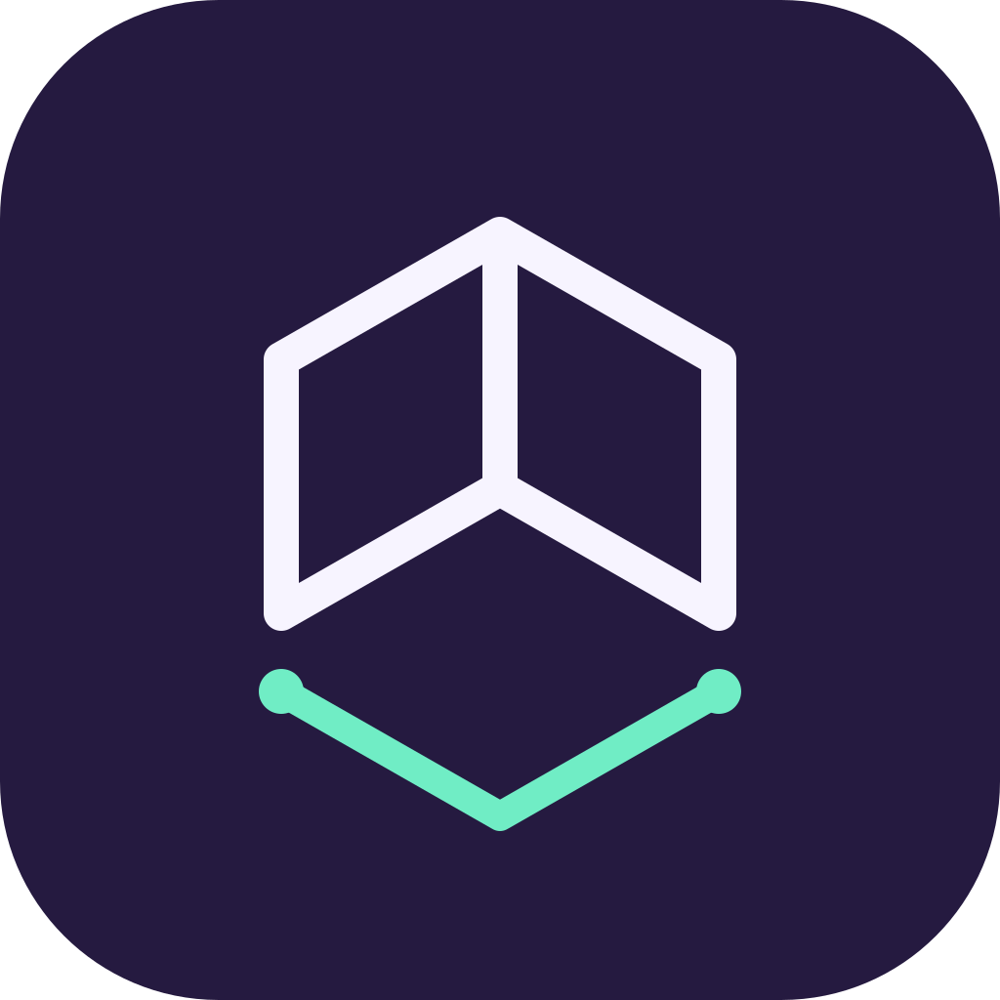

# Kantura — Scan. See. Measure.

An independent RTAB-Map fork focused on rooms, outdoor objects and understandable
measurements. The **0.6.0 development preview** combines guided iPhone capture,
RoomPlan, separate rooms grouped by building/floor, and a browser workspace for
models, dimensions, areas and photo notes.

Implemented capture paths include textured LiDAR, Apple Object Capture, guided
photo sets, video, panorama photos and a single original image for optional AI
object generation. The private server exposes four explicit jobs: **photo mesh,
Gaussian splat, panorama stitching and generated 3D**. Mesh/splat jobs also accept
bounded video input and an aerial-photo profile. Each path preserves its meaning:
a photo set is input, a panorama has no depth, and generated unseen geometry is
not a measured scan. Generated models and splats are not measurement surfaces.

The guided dashboard, room workflow, browser, reports and tutorials support
15 languages: German, English, French, Spanish, Italian, Simplified Chinese,
Portuguese, Arabic, Hindi, Bengali, Russian, Japanese, Korean, Indonesian and Turkish.
Inherited RTAB-Map expert menus retain upstream English text.

- [iPhone installation and capture modes](app/ios/README.md) · [Guided measurement workflow](app/ios/MEASUREMENT-WORKFLOW.md)
- [Desktop workspace and all four processing modes](tools/scan-workspace/README.md)
- [Self-host with Docker and a private project library](tools/scan-workspace/README-server.md)
- [Reconstruction worker](tools/reconstruction/README.md) · [Panorama engine](tools/panorama/README.md) · [Optional image-to-3D engine](tools/generation/README.md)
- [Capture quality and measurement checks](docs/CAPTURE-QUALITY.md) · [Validation status](tools/scan-workspace/VALIDATION.md)
- [Independent App Store release requirements](docs/APP-STORE-RELEASE.md)
- [Name and logo](tools/scan-workspace/BRAND.md)
- [Usability review against MetaRoom and device acceptance checklist](docs/usability-review.md)
- [Polycam capability roadmap](docs/POLYCAM-ROADMAP.md) · [Independent implementation and source provenance](docs/INDEPENDENT-IMPLEMENTATION.md)
- [Contribute: development, translations and device testing](CONTRIBUTING.md) — [Deutsch](docs/contributing/de.md) · [Français](docs/contributing/fr.md) · [Español](docs/contributing/es.md) · [Italiano](docs/contributing/it.md) · [简体中文](docs/contributing/zh-Hans.md)
- [Community issues](https://github.com/lukashold/rtabmap/issues)

Confirmed 0.6 checks include an [unsigned full iOS build](https://github.com/lukashold/rtabmap/actions/runs/38207033828),
[150 web tests and the viewer Docker build](https://github.com/lukashold/rtabmap/actions/runs/38207033794),
and [real offline Docker panorama/TripoSR engine runs](https://github.com/lukashold/rtabmap/actions/runs/38207033832).
These do not prove phone behavior or measurement accuracy. A periodic synthetic
photo fixture reconstructed with incorrect camera geometry and is **not quality
accepted**; the distinct-texture fixture and the combined job API still require
their documented end-to-end results. See validation for the latest corrective runs.

A signed iPhone test, native WKWebView rendering and real-account cloud OAuth remain
open. Separate rooms are not automatically aligned; drone inputs are not GPS
georeferenced. Videos show synthetic animated demonstrations. AI generation is an
optional build (`ENABLE_GENERATION=0` by default), adding about 1.68 GB of weights
and a separate Torch runtime; budget 12 GiB of runtime memory. The configured
engines run locally after installation, without runtime model downloads.

RTAB-Map attribution and the repository license remain intact. Dependencies and
model weights have their own licenses: the complete server/native bundle is not
uniformly BSD-licensed or a cleared App Store release. The upstream contribution
remains separate from this branded fork.

---

rtabmap
=======

[![Release][release-image]][releases]
[![Downloads][downloads-image]][downloads]

[![License][license-image]][license]

[release-image]: https://img.shields.io/github/v/release/introlab/rtabmap?color=green&style=flat
[releases]: https://github.com/introlab/rtabmap/releases

[downloads-image]: https://img.shields.io/github/downloads/introlab/rtabmap/total?label=downloads
[downloads]: https://github.com/introlab/rtabmap/releases

[license-image]: https://img.shields.io/badge/license-BSD-green.svg?style=flat
[license]: https://github.com/introlab/rtabmap/blob/master/LICENSE

RTAB-Map library and standalone application.

 * For more information (e.g., papers, major updates), visit [RTAB-Map's home page](http://introlab.github.io/rtabmap).
 * For installation instructions and examples, visit [RTAB-Map's wiki](https://github.com/introlab/rtabmap/wiki).
 * For the C++ API of the library, see the [API documentation](https://introlab.github.io/rtabmap/api/latest/), which also lists all [parameters](https://introlab.github.io/rtabmap/api/latest/parameters.html) and [command-line tools](https://introlab.github.io/rtabmap/api/latest/tools.html).

To use RTAB-Map under ROS, visit the [rtabmap](http://wiki.ros.org/rtabmap) page on the ROS wiki.

### Acknowledgements
This project is supported by [IntRoLab - Intelligent / Interactive / Integrated / Interdisciplinary Robot Lab](https://introlab.3it.usherbrooke.ca/), Sherbrooke, Québec, Canada.

#### CI Latest

| | Build |
|---|---|
| Desktop |    |
| ROS |   |
| Mobile |   |
| Quality |   |
 
 #### ROS Binaries
 
 `ros-$ROS_DISTRO-rtabmap`
 
| | Distro | Ubuntu | Released | In apt | Build |
|---|---|---|---|---|---|
| ROS 1 | Noetic (EOL) | 20.04 |  |  |  |
| ROS 2 | Humble | 22.04 |  |  |  |
| ROS 2 | Iron (EOL) | 22.04 |  |  |  |
| ROS 2 | Jazzy | 24.04 |  |  |  |
| ROS 2 | Kilted | 24.04 |  |  |  |
| ROS 2 | Lyrical | 26.04 |  |  |  |
| ROS 2 | Rolling | 26.04 |  |  |  |
| Docker | [rtabmap](https://hub.docker.com/r/introlab3it/rtabmap) | | |  | |

*Released* is the version bloomed into [rosdistro](https://github.com/ros/rosdistro); *In apt* is what `apt install` actually gives you today. They differ while a release is waiting on a buildfarm sync.
